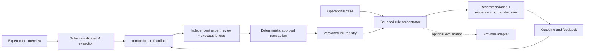

# Architecture

## Decision

Python 3.11+, FastAPI, Pydantic 2, SQLite, HTTPX and pytest. A modular monolith gives typed contracts, portable JSON schema and transactional governance with minimal infrastructure. SQLite is appropriate for one demo server on a local disk; migration to PostgreSQL is a future concurrency/operations choice. No vector database: evidence is explicitly referenced, and reusable judgement lives in rules.

## Domain and boundaries

`PillContent` is the portable knowledge artifact: scope, typed inputs, observations, assumptions, exceptions, action catalogue, finite rules, guardrails, evidence, pinned dependencies and executable cases. `PillVersion` adds server-owned identity, version, lifecycle status, content hash, authorship and release history. The JSON Schema is generated from the same Pydantic definitions used at API boundaries.

Rule evaluation uses a finite declarative language (all conditions; eq/ne/gt/gte/lt/lte). There is no eval, code execution, dynamic import or model tool use. Effects are allowlisted advisory recommendations, blocks and escalation. Blocks dominate recommendations across both Pills; escalation dominates ordinary human review. Missing, stale, invalid or contradictory-quality evidence causes abstention. No hardware or messaging integration exists.

All versions have immutable content, including drafts. Correct a draft by creating another candidate. Status changes only through lifecycle endpoints. Review and validation attach to the exact content hash. The author cannot review their own artifact. Only the owner, when authenticated with approver role, may approve, and cannot approve their own authored artifact. Reviewer identity must be in the Pill's reviewer list. Any candidate with unresolved questions/contradictions cannot release. Release checks current parent, version order, tests and pinned dependencies in one `BEGIN IMMEDIATE` transaction. The current release is superseded atomically. Stale sibling candidates cannot win later.

Persistence uses numbered SQL migrations, foreign keys, a unique current-release index, immutable-content triggers and append-only audit triggers. Writes and their audit events share a transaction. Audit is append-oriented locally, not cryptographically tamper-proof against a database administrator. Historical recommendations retain complete deterministic results and content hashes. Archived versions remain readable but cannot be newly invoked in production.

## AI boundary

`LLMProvider.structured_generate` is the sole model interface. Versioned prompts support extraction, proposed revision and a small optional explanation. The deterministic provider replays only exact labelled demo fixtures; it is not represented as real inference. Live compatible providers receive JSON schema and bounded context; output is parsed and schema-validated before storage. Model output cannot supply lifecycle status, identities, role grants or release operations.

Runtime decisions are deterministic. A model explanation is an explicitly untrusted supplement and cannot change actions, escalation, rule matches or provenance. A failed extraction/revision creates no artifact and returns a predictable error. A failed runtime explanation leaves the governed recommendation intact with a degraded-provider label. Network calls occur outside database write locks; stale-parent checks occur again inside the write transaction.

Tencent TokenHub is the selected live edge (international endpoint by default, configurable for account region); a generic compatible adapter and offline fixture adapter preserve portability. There is no claim of live Tencent use until credentials and a successful evidence record exist.

## API, identity and deployment

REST under `/api/v1`; generated OpenAPI plus example payloads. Bearer tokens resolve to server-configured identities and roles, never client-supplied actor headers. Demo tokens are explicitly insecure fixtures and the default command binds loopback. Production mode refuses demo identity configuration. This is single-organisation RBAC, not SSO or multi-tenant isolation. CORS has explicit configured origins. Unexpected failures return a sanitised error with a request ID.

One SQLite file, one API process, local CLI/API demo. Docker is optional and uses a persistent local volume. Production needs TLS, identity-provider integration, backups/restore testing, rate limiting, retention policy, independent domain validation and operational monitoring. These are documented limits, not hackathon infrastructure to implement speculatively.
